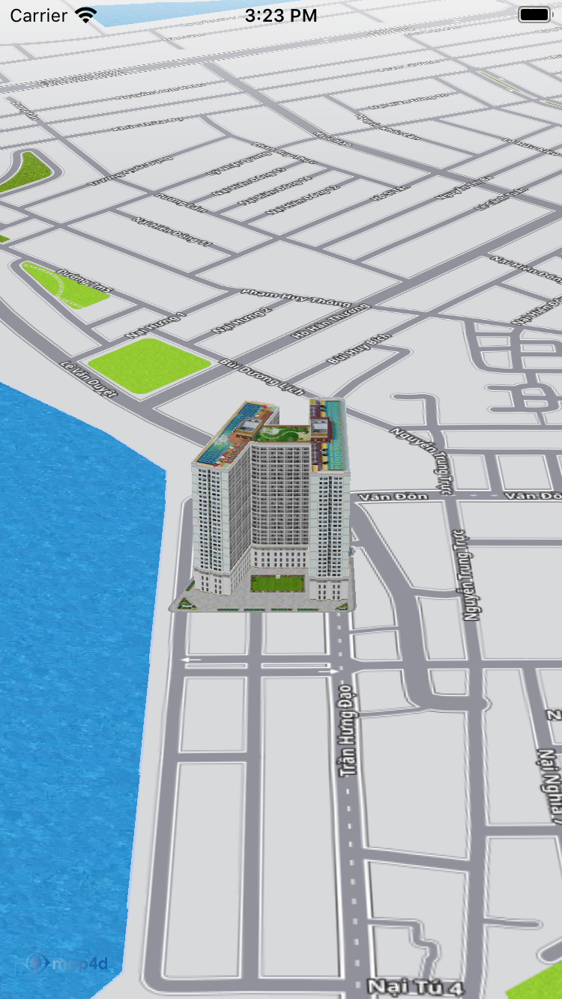

# Building
Lớp MFBuilding cho phép người dùng vẽ một building lên map.


## 1. MFBuilding

```objc
@interface MFPOI : MFOverlay
@interface MFBuilding : MFOverlay
    @property(nonatomic, strong, nullable) NSString* name;
    @property(nonatomic) CLLocationCoordinate2D position;
    @property(nonatomic, strong, nullable) NSString* model;
    @property(nonatomic, strong, nullable) NSString* texture;
    @property(nonatomic, strong, nullable) MFPath* coordinates;
    @property(nonatomic) double height;
    @property(nonatomic) double scale;
    @property(nonatomic) CGFloat bearing;
    @property(nonatomic) double elevation;
    @property(nonatomic, getter=isSelected) bool selected;
    @property(nonatomic, getter=isUserInteractionEnabled) bool userInteractionEnabled;
    - (instancetype _Nonnull) init;
@end
```  

- Properties:
    + name: Tên building
    + position: vị trí vẽ building
    + model: đường dẫn http chứa model của building
    + texture: đường dẫn http chứ texture của building
    + coordinates: model của building dưới dạng các coordinate (chỉ cần sử dụng một trong 2 property model hoặc coordinates để tạo building)
    + selected: set là true nếu muốn hiển thị building dưới dạng được chọn (có viền đỏ bao quanh)
    + userInteractionEnabled: cho phép building bị tác động bởi người dùng hay không, nếu building nào có userInteractionEnabled là false thì sẽ bỏ qua sự kiện click đối với building đó

## 2. Tạo Building

  -   
  
```swift
  let building = MFBuilding()
  building.position = CLLocationCoordinate2DMake(16.08795975082965, 108.22837829589844)
  building.name = "User Building"
  building.model = "https://hcm03.vstorage.vngcloud.vn/v1/AUTH_b32b6bc102c44269ab7b55e7820e7116/sdk/models/5db6b4798b4711141457d8a9.obj"
  building.texture = "https://hcm03.vstorage.vngcloud.vn/v1/AUTH_b32b6bc102c44269ab7b55e7820e7116/sdk/textures/5db6b4798b4711141457d8ab.jpg"
  building.map = mapView
```

## 3. Sự kiện click Building

  - Phát sinh khi người dùng click vào POI
    ```objc
      - (void)mapView: (MFMapView*)  mapView didTapBuilding: (MFBuilding*) building;
    ```


License
-------

Copyright (C) 2020 IOT Link Ltd. All Rights Reserved.