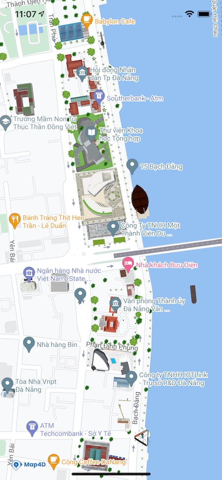
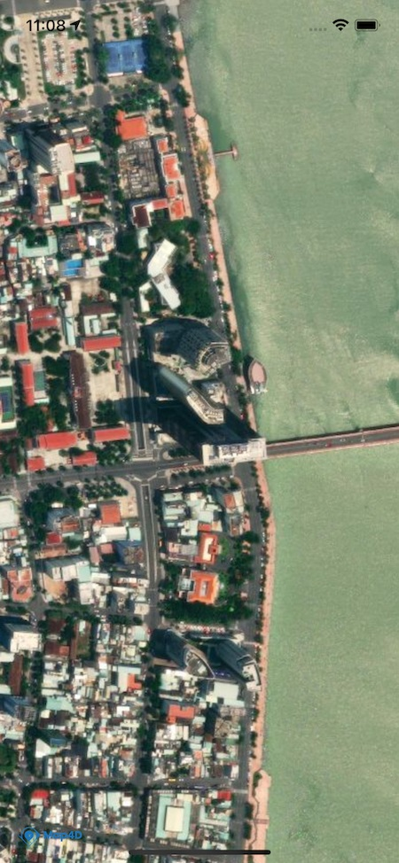
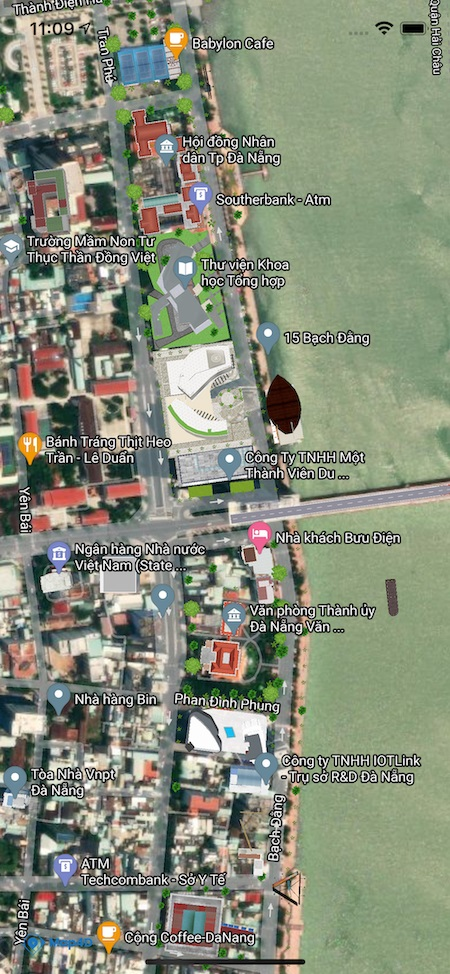

# Map Types

> Map type xác định cách hiển thị và trình bày các tiles trong bản đồ. Bạn có thể tùy chỉnh bản đồ của mình bằng một số loại mà iPostMap Map SDK cung cấp

### Các loại bản đồ

iPostMap Map SDK hiện cung cấp 3 loại bản đồ tùy chỉnh:

| No. | Name      | Description                                                                                                                                                           |
|:---:|-----------|-----------------------------------------------------------------------------------------------------------------------------------------------------------------------|
|  1  | Roadmap   | Giá trị: `.roadmap`<br>Các thành phần của bản đồ được vẽ dưới dạng các đường nét và hình khối, có độ phân giải cao<br>Đây là bản đồ mặc định của iPostMap SDK |
|  2  | Satellite | Giá trị: `.satellite`<br>Các tiles của bản đồ được hiển thị dưới dạng hình ảnh vệ tinh. Không có thông tin về đường sá.                                       |
|  3  | Hybrid    | Giá trị: `.hybrid`<br>Các tiles của bản đồ được hiển thị dưới dạng hình ảnh vệ tinh, kết hợp thông tin về đường sá                                             |

|                 ROADMAP                            | SATELLITE                                             |                 HYBRID                            |
|:--------------------------------------------------:|:-----------------------------------------------------:|:-------------------------------------------------:|
|  |  |  |

### Thay đổi loại bản đồ

Để thay đổi loại bản đồ, ta gán một giá trị cho property `mapType` của class [MFMapView](/guides/map-options?id=mfmapview)<br>
Ví dụ: để hiển thị bản đồ dạng kết hợp ảnh vệ tinh và thông tin đường sá:

```swift
mapView.mapType = .hybrid
```
