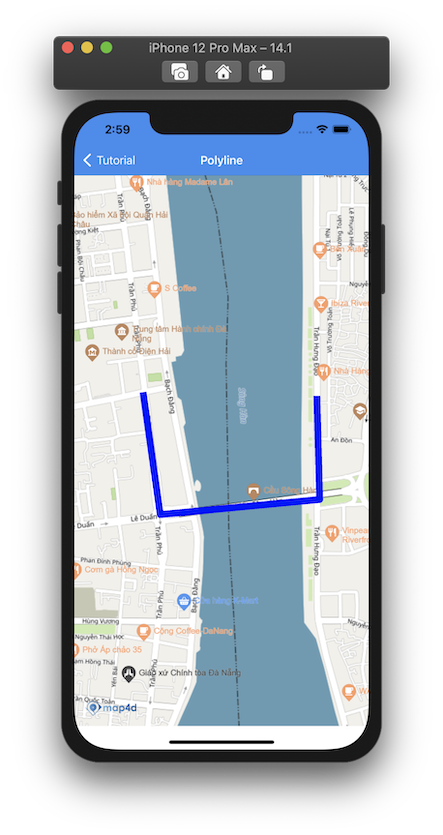
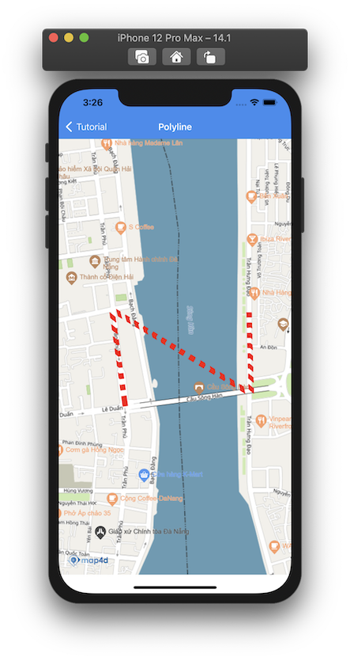

# Polyline

> Để vẽ các đường thẳng trên bản đồ thì ta sử dụng đối tượng **MFPolyline**. Một đối tượng **MFPolyline** bao gồm một mảng các điểm tọa độ
và tạo ra các đoạn thẳng nối các vị trí đó theo một trình tự có thứ tự.

### 1. Thêm một Polyline

Đoạn mã sau sẽ vẽ **Polyline** lên bản đồ:

```swift 
let polyline = MFPolyline()
let path = MFMutablePath()
path.add(CLLocationCoordinate2D(latitude: 16.075370898415514, longitude: 108.22887796703878))
path.add(CLLocationCoordinate2D(latitude: 16.072266586439582, longitude: 108.22896530020222))
path.add(CLLocationCoordinate2D(latitude: 16.07181296817015, longitude: 108.22398711335603))
path.add(CLLocationCoordinate2D(latitude: 16.07548312266711, longitude: 108.22345067080795))
polyline.path = path
polyline.width = 10.0
polyline.color = .blue
polyline.map = mapView
```

-   

Bạn có thể tùy chỉnh hình dáng của **Polyline** trước khi thêm nó vào bản đồ hoặc sau khi nó đã được thêm vào bản đồ.

### 2. Xóa Polyline khỏi bản đồ

Để xóa **Polyline** khỏi bản đồ, chúng ta **set** thuộc tính **map** bằng **nil**

```swift
polyline.map = nil
```

### 3. Tùy chỉnh cho Polyline

Bạn có thể dễ dàng tuỳ chỉnh hình dáng của **Polyline** thông qua các thuộc tính mà **MFPolyline** cung cấp như
 
| Name                       |Description                                                                                                              |
|----------------------------|-------------------------------------------------------------------------------------------------------------------------|
| **path**                   | Truyền vào một mảng các tọa độ **CLLocationCoordinate2D** để tạo **Polyline**.                                          |
| **width**                  | Tuỳ chỉnh độ rộng của **Polyline**.                                                                                     |
| **color**                  | Tuỳ chỉnh màu sắc của **Polyline**.                                                                                     |
| **strokePattern**          | Tuỳ kiểu vẽ cho polyline (có 4 kiểu là: solid, dash, dot và icon).                          |

```swift    
let path = MFMutablePath()
path.add(CLLocationCoordinate2D(latitude: 16.075370898415514, longitude: 108.22887796703878))
path.add(CLLocationCoordinate2D(latitude: 16.072266586439582, longitude: 108.22896530020222))
path.add(CLLocationCoordinate2D(latitude: 16.07548312266711, longitude: 108.22345067080795))
path.add(CLLocationCoordinate2D(latitude: 16.07181296817015, longitude: 108.22398711335603))
polyline.path = path
polyline.width = 10.0
polyline.color = .red
polyline.strokePattern = MFStrokePattern.dash(length: 5, gap: 5)
```

-  

---

## API Reference :id=api-polyline

`MFPolyline` class

#### Constructor :id=api-polyline-constructor

```swift 
let polyline = MFPolyline()
```

#### Properties :id=api-polyline-properties

| Name                       | Type                   | Description                                                                                                             |
|----------------------------|:-----------------------|-------------------------------------------------------------------------------------------------------------------------|
| **path**                   | MFPath                 | Truyền vào một mảng các tọa độ **CLLocationCoordinate2D** để tạo Polyline.**Polyline**.                                 |
| **width**                  | CGFloat                | Chỉ định độ rộng của **Polyline** theo đơn vị point.                                                                    |
| **strokePattern**          | MFStrokePattern        | Chỉ định kiểu vẽ cho polyline                                                                                           |
| **color**                  | UIColor                 | Chỉ định màu sắc của **Polyline**.                                                                                      |
| **isUserInteractionEnabled** | Bool                   | Cho phép người dùng có thể tương tác được với **Polyline** hay không. Giá trị mặc định là **true**. Khi không cho phép người dùng tương tác với **Polyline** thì tất cả các sự kiện liên quan tới **Polyline** từ phía người dùng sẽ không có tác dụng.                                                                         |
| **isHidden**               | Bool                   | Xác định **Polyline** có thể ẩn hay hiện trên bản đồ. `true` để ẩn, `false` để hiện.                                     |
| **zIndex**                 | Float                  | Chỉ định thứ tự hiển thị giữa các Polyline với nhau hoặc giữa **Polyline** với các đối tượng khác trên bản đồ. Giá trị mặc định là **0** |
| **userData**               | NSObject               | Cho phép người dùng lưu trữ thông tin trên **Polyline**.                                                                |
| **map**                    | [MFMapView](/guides/map.md?id=api-map-mfmapview)              | Chỉ định hiển thị **Polyline** trên **Map** hoặc xoá **Polyline** khỏi **Map**           |
| **Id**                     | UInt32                 | **Id** của **Polyline** **{get}**.                                                                                      |

#### Delegate :id=api-polyline-delegate

  > **Chú ý**: Để sử dụng sự kiện của **Polyline** phải **set** thuộc tính **isUserInteractionEnabled** = **true**
  
  **Touch Polyline**

  Phát sinh khi người dùng **touch** vào **Polyline**
  </br>Cung cấp thông tin của **Polyline** cho người dùng

  ```swift
  func mapView(_ mapView: MFMapView!, didTap polyline: MFPolyline!) {}
  ```


### MFStrokePattern

```swift
polyline.strokePattern = .solid
polyline.strokePattern = .dash(length: 5, gap: 5)
polyline.strokePattern = .dot(repeat: 10)
if let image = UIImage(named: "arrow") {
  polyline.strokePattern = .icon(image: image)
}
polyline.color = UIColor.red.withAlphaComponent(0.5)
```

`MFStrokePattern.type` chỉ đọc, có các giá trị `.solid`, `.dash`, `.dot`, `.icon`.
