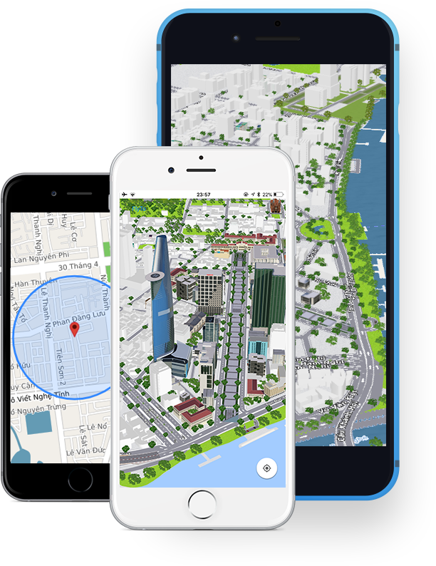

# iPostMap iOS SDK
[](https://ipostmap.vn/)
[](https://www.apple.com/ios/)
[](https://cocoapods.org/pods/iPostMap)

> **iPostMap iOS SDK** cho phép bạn tùy chỉnh bản đồ với nội dung để hiển thị trên iPhone, iPad.<br>
> **iPostMap iOS SDK** không chỉ mang hình ảnh thực tế lên trên bản đồ 3D, ngoài ra còn cho phép tương tác và điều chỉnh các đối tượng 3D của bạn



Tài liệu dành cho **iPostMap 3.1.0** từ [ipostmap-ios-sdk](https://github.com/map4d/ipostmap-ios-sdk).

## Yêu cầu

- iOS 12.0 trở lên.
- Xcode 12.0 trở lên.
- Access Key từ [iPostMap Developer](https://map.ipostmap.vn/developer/key) (yêu cầu tài khoản đã kích hoạt developer).

## Installation

### Swift Package Manager

Trong Xcode, chọn **File > Add Package Dependencies**, nhập URL:

```text
https://github.com/map4d/ipostmap-ios-sdk.git
```

Chọn phiên bản **3.1.0** trở lên và thêm product **iPostMap** vào app target.

### CocoaPods

Thêm vào `Podfile`:

```ruby
platform :ios, '12.0'

target 'YourApp' do
  pod 'iPostMap'
end
```

Sau đó chạy và mở file `.xcworkspace` để làm việc:

```shell
pod install --repo-update
```

## Using

1. Thêm Access Key vào `Info.plist` của app target. Tên khóa cấu hình là `Map4dMapAccessKey`:  
Key lấy từ [iPostMap Developer](https://map.ipostmap.vn/developer/key) (yêu cầu tài khoản đã kích hoạt developer)

```xml
<key>Map4dMapAccessKey</key>
<string>YOUR_ACCESS_KEY</string>
```

2. Import `iPostMap` và tạo map view:

```swift
import UIKit
import iPostMap

class ViewController: UIViewController {
  override func viewDidLoad() {
    super.viewDidLoad()
    let mapView = MFMapView(frame: self.view.frame)
    view = mapView
  }
}
```
