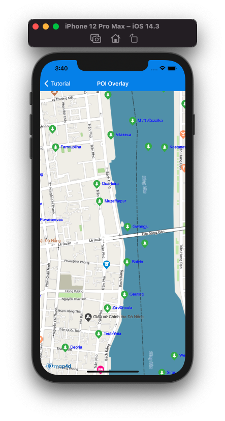

# POI Overlay

POI overlay là một loại overlay cho phép người dùng hiển thị các POI từ nhiều nguồn khác nhau lên bản đồ.<br>
Các POI của POI overlay được ưu tiên hiển thị so với POI của iPostMap và chỉ hiển thị ở chế độ 2D.



## Add POI overlay

Để thêm 1 lớp POI overlay vào map cần tạo mới 1 đối tượng của lớp [MFURLPOILayer](/guides/poi-overlay?id=mfurlpoilayer-class) sau đó set map cho POI overlay đó.
Để tạo đối tượng [MFURLPOILayer](/guides/poi-overlay?id=mfurlpoilayer-class) thì cần phải implement [MFPOIURLConstructor](/guides/poi-overlay?id=mfurlpoilayer-class)

Implement **MFPOIURLConstructor** protocol yêu cầu 2 phương thức `getPOIUrlWith` và `parserPOIData`.<br>
Trong đó:<br>
- getPOIUrlWith: Nhận vào các giá trị là toạ độ x, y và mức zoom của tile, kết quả là một kiểu [URL](https://developer.apple.com/documentation/foundation/url) chỉ đến rest api cung cấp dữ liệu POI theo tile.
- parserPOIData: Nhận vào là dữ liệu được về từ api cung cấp bởi *getPOIUrlWith*, ta sẽ phải parser dữ liệu đó thành mảng các đối tượng [MFPOIData](/guides/poi-overlay?id=mfpoidata-class)

### Tạo mới POI overlay

Đoạn code bên dưới hướng dẫn việc implement [MFPOIURLConstructor](/guides/poi-overlay?id=mfurlpoilayer-class) và sử dụng [MFURLPOILayer](/guides/poi-overlay?id=mfurlpoilayer-class) để hiển thị POI overlay lấy từ `poi-random.herokuapp.com`

Implement **MFPOIURLConstructor**
```swift
class POIURLConstructor : NSObject, MFPOIURLConstructor {
    func getPOIUrlWith(x: UInt, y: UInt, zoom: UInt) -> URL? {
        let poiApiUrl = "https://poi-random.herokuapp.com/poi/\(zoom)/\(x)/\(y)"
        return URL(string: poiApiUrl)
    }

    func parserPOIData(_ data: String) -> [MFPOIData]? {
        do {
            var poiDatas:[MFPOIData] = []
            let decoder = JSONDecoder()
            let poisJson = try decoder.decode(POIsJson.self, from: data.data(using: .utf8)!)

            guard let places = poisJson.pois else { return nil }
            for place in places {
                let position = CLLocationCoordinate2DMake(place.position?.lat ?? 0, place.position?.lng ?? 0)
                let poi = MFPOIData(id: place.id ?? "", position: position, title: place.title)
                poi.color = .blue
                poi.type = "park"
                poiDatas.append(poi)
            }
            return poiDatas;
        } catch let err {
            print(err.localizedDescription)
            return nil
        }
    }
}
```

Create **MFURLPOILayer** và set **map**
```swift
let poiURLConstructor = POIURLConstructor()
let poiOverlay = MFURLPOILayer(urlConstructor: poiURLConstructor, prefixId: "poi-overlay")
poiOverlay.map = mapView
```

### Add POI overlay lên Map

Để vẽ POI overlay lên map, ta set map view cho property `map` của đối tượng poi overlay

```swift
poiOverlay.map = mapView
```

### Remove POI overlay

Để xóa POI overlay khỏi map, ta gọi hàm `setMap` và truyền vào giá trị `null`

```swift
poiOverlay.map = nil
```

### Ẩn/Hiện POI Overlay

Để ẩn/hiện POI overlay, ta set giá trị cho property `isHidden` của đối tượng.<br>
**Chú ý:** Mặc dù POI overlay không hiển thị nhưng quá trình tải các POI vẫn diễn ra

```swift
poiOverlay.isHidden = true;
```

## Sự kiện đối với POI thuộc POI overlay

Khi người dùng click POI thuộc POI overlay thì sẽ phát sinh sự kiện tương tự với POI của iPostMap, việc xử lý được diễn ra ngay tại hàm xử lý sự kiện của iPostMap.

```swift
func mapView(_ mapView: MFMapView!, didTapPOIWithPlaceID placeID: String!, name: String!, location: CLLocationCoordinate2D)
```

Xem thêm [Events](/guides/map-events)

## API Reference

<a id="reference-poi-overlay"></a>

## POI Overlay References

## MFURLPOILayer class

`MFURLPOILayer` class

**Constructor**

Lớp `MFURLPOILayer` cho phép tạo đối tượng trong Swift *MFURLPOILayer* một cách tiện lợi
```swift
let poiOverlay = MFURLPOILayer(urlConstructor: poiURLConstructor)
let prefixedOverlay = MFURLPOILayer(urlConstructor: poiURLConstructor, prefixId: "poi-overlay-")
```

- Parameters:
  - urlConstructor: [MFPOIURLConstructor](#mfpoiurlconstructor-protocol) *required*
  - prefixId: [NSString](https://developer.apple.com/documentation/foundation/nsstring)

Sử dụng
```swift
let poiOverlay = MFURLPOILayer(urlConstructor: poiURLConstructor, prefixId: "poi-overlay-")
```

**Methods**

| Name              | Parameters  | Return Value | Description                                                           |
|-------------------|-------------|--------------|-----------------------------------------------------------------------|
| **clearPOICache** | `none`      | `none`       | Xoá cache của đối tượng poi overlay và load lại dữ liệu poi từ server |

**Properties**

| Name         | Type      | Description                                                                            |
|--------------|-----------|----------------------------------------------------------------------------------------|
| **map**      | [MFMapView](/guides/map-options?id=mfmapview) | Map view sẽ hiển thị poi overlay |
| **isHidden** | bool                                           | Ẩn/hiện poi overlay trên map |
| **prefixId** | NSString                                       | Giá trị được thêm vào trước mỗi id của POI thuộc POI overlay |

## MFPOIURLConstructor protocol

`MFPOIURLConstructor` protocol

MFPOIURLConstructor là một protocol, định nghĩa sẵn 2 phương thức dùng để xác định URL api lấy dữ liệu POIs và xử lý parser data được lấy từ api.

```swift
func getPOIUrlWith(x: UInt, y: UInt, zoom: UInt) -> URL?
func parserPOIData(_ data: String) -> [MFPOIData]?
```

Cần phải implement protocol này trước khi tạo đối tượng `MFURLPOILayer`

## MFPOIData class

`MFPOIData`class

MFPOIData là object chứa thông tin của POI để iPostMap SDK có thể hiểu được, người sử dụng POI overlay sẽ thực hiện implement phương thức `parserPOIData` để biến đổi dữ liệu trả về từ server của mình thành mảng các POI data cung cấp cho iPostMap SDK hiển thị lên bản đồ.

| Name             | Type      | Description                                                                            |
|------------------|-----------|----------------------------------------------------------------------------------------|
| **id**           | NSString               | ID của POI |
| **position**     | CLLocationCoordinate2D | Vị trí toạ độ của POI hiển thị trên bản đồ |
| **title**        | NSString               | Tiêu đề của POI  |
| **color**        | UIColor                | Màu cho icon (nếu sử dụng `type`) và tiêu đề của POI |
| **type**         | NSString               | Kiểu của POI *("bank", "atm", "park", ...)*, tuỳ thuộc vào kiểu mà POI có icon tương ứng  |
| **iconUrl**      | NSURL                  | Đường dẫn để lấy icon cho POI. Nếu option này được set giá trị thì hình ảnh của POI sẽ lấy theo URL này mà không cần quan tâm tới option type |
| **zIndex**       | float                  | Độ ưu tiên hiển thị của POI đối với POI khác  |
