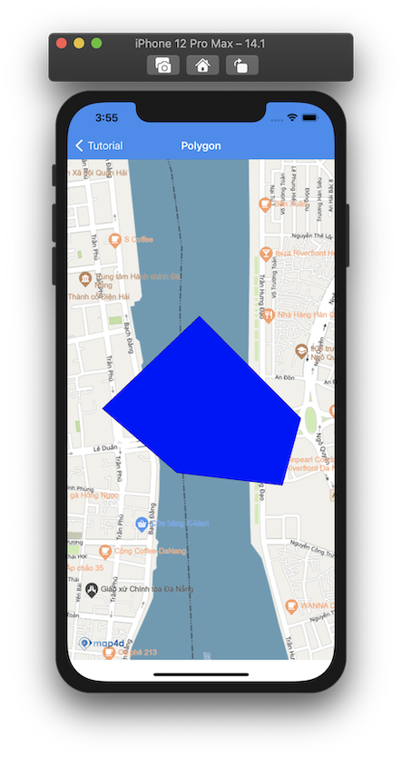
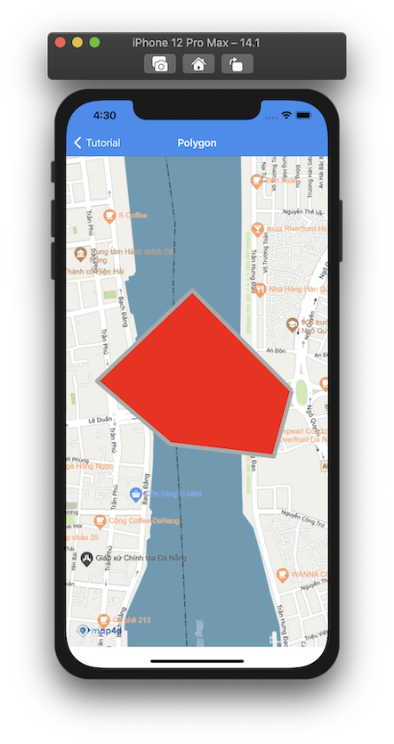
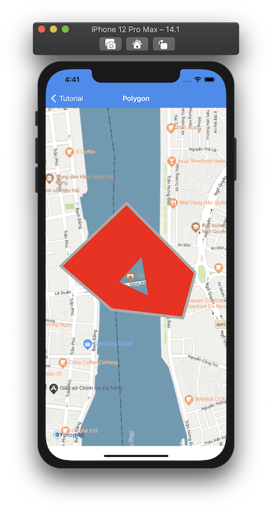

# Polygon

> Để vẽ các đa giác trên bản đồ thì ta sử dụng đối tượng MFPolygon. Một đối tượng MFPolygon bao gồm một mảng các điểm tọa độ
và tạo ra các đoạn thẳng nối các vị trí đó theo một trình tự có thứ tự.

### 1. Tạo một Polygon

Đoạn mã sau sẽ vẽ **Polygon** lên bản đồ:

```swift
let path = MFMutablePath()
path.add(CLLocationCoordinate2D(latitude: 16.072699584731552, longitude: 108.23020984691385))
path.add(CLLocationCoordinate2D(latitude: 16.07608106276882, longitude: 108.22671224150031))
path.add(CLLocationCoordinate2D(latitude: 16.0730244298952, longitude: 108.22336243622124))
path.add(CLLocationCoordinate2D(latitude: 16.070900670809152, longitude: 108.22593736045201))
path.add(CLLocationCoordinate2D(latitude: 16.070485456927244, longitude: 108.22957624088468))

let polygon = MFPolygon()
polygon.path = path
polygon.fillColor = .blue
polygon.map = mapView
```



Bạn có thể tùy chỉnh hình dáng của **Polygon** trước khi thêm nó vào bản đồ hoặc sau khi nó đã được thêm vào bản đồ.

### 2. Xóa Polygon khỏi bản đồ

Để xóa **Polygon** khỏi bản đồ, chúng ta **set** thuộc tính **map** bằng **nil**

```swift
polygon.map = nil
```

### 3. Tùy chỉnh cho Polygon

Bạn có thể dễ dàng tuỳ chỉnh hình dáng của **Polygon** thông qua các thuộc tính mà **MFPolygon** cung cấp như

| Name                       |Description                                                                                                              |
|----------------------------|-------------------------------------------------------------------------------------------------------------------------|
| **path**                   | Truyền vào một mảng các tọa độ **CLLocationCoordinate2D** để tạo **Polygon**.                                           |
| **fillColor**              | Tuỳ chỉnh màu của **Polygon**.                                                                                          |
| **strokeWidth**            | Tuỳ chỉnh độ rộng **đường viền Polygon**.                                                                               |
| **strokeColor**            | Tuỳ chỉnh màu sắc của **đường viền Polygon**.                                                                           |

```swift<br>
polygon.fillColor = .red
polygon.strokeWidth = 20.0
polygon.strokeColor = .lightGray
```



### 4. Polygon có hole

**Polygon có hole** cũng tương tự như **Polygon** cũng mang các thuộc tính của **Polygon thông thường**, chỉ đặt biệt là
nó có thêm các hole bên trong.

Đoạn mã sau sẽ vẽ **Polygon có hole** lên bản đồ:

```swift
let path = MFMutablePath()
path.add(CLLocationCoordinate2D(latitude: 16.072699584731552, longitude: 108.23020984691385))
path.add(CLLocationCoordinate2D(latitude: 16.07608106276882, longitude: 108.22671224150031))
path.add(CLLocationCoordinate2D(latitude: 16.0730244298952, longitude: 108.22336243622124))
path.add(CLLocationCoordinate2D(latitude: 16.070900670809152, longitude: 108.22593736045201))
path.add(CLLocationCoordinate2D(latitude: 16.070485456927244, longitude: 108.22957624088468))
path.add(CLLocationCoordinate2D(latitude: 16.072699584731552, longitude: 108.23020984691385))

let hole = MFMutablePath()
hole.add(CLLocationCoordinate2D(latitude: 16.073472611109437, longitude: 108.22747377269246))
hole.add(CLLocationCoordinate2D(latitude: 16.071575666602996, longitude: 108.22781709595301))
hole.add(CLLocationCoordinate2D(latitude: 16.072503522154975, longitude: 108.22573569886646))
hole.add(CLLocationCoordinate2D(latitude: 16.073946844408653, longitude: 108.22612193750109))

let polygon = MFPolygon()
polygon.path = path
polygon.holes = [hole]
polygon.fillColor = .red
polygon.strokeWidth = 20.0
polygon.strokeColor = .lightGray
polygon.map = mapView
```



## API Reference

<a id="reference-polygon"></a>

## Polygon reference

`MFPolygon` class

### Constructor

```swift
let polygon = MFPolygon()
```

### Properties

| Name                       | Type                   | Description                                                                                                             |
|----------------------------|:-----------------------|-------------------------------------------------------------------------------------------------------------------------|
| **path**                   | MFPath                 | Truyền vào một mảng các tọa độ **CLLocationCoordinate2D** để tạo Polygon.**Polygon**.                                   |
| **holes**                  | NSArray<MFPath*>       | Truyền vào một mảng hoặc nhiều mảng các tọa độ **CLLocationCoordinate2D** để tạo **Holes** cho **Polygon**.             |
| **fillColor**              | UIColor                | Chỉ định màu tô phía trong của **Polygon**.                                                                             |
| **strokeColor**            | UIColor                | Chỉ định màu sắc đường viền ngoài cùng của **Polygon**.                                                                 |
| **strokeWidth**            | CGFloat                | Chỉ định độ rộng đường viền của Polygon theo đơn vị point.                                                              |
| **userInteractionEnabled** | BOOl                | Cho phép người dùng có thể tương tác được với **Polygon** hay không. Giá trị mặc định là **true**. Khi không cho phép người dùng tương tác với **Polygon** thì tất cả các sự kiện liên quan tới **Polygon** từ phía người dùng sẽ không có tác dụng.                                                                           |
| **isHidden**               | BOOl                   | Xác định **Polygon** có thể ẩn hay hiện trên bản đồ. Giá trị mặc định là **true**.                                      |
| **zIndex**                 | float                  | Chỉ định thứ tự hiển thị giữa các **Polygon** với nhau hoặc giữa **Polygon** với các đối tượng khác trên bản đồ. Giá trị mặc định là **0** |
| **userData**               | NSObject               | Cho phép người dùng lưu trữ thông tin trên **Polygon**.                                                                 |
| **map**                    | [MFMapView](/guides/map-options?id=mfmapview)              | Chỉ định hiển thị **Polygon** trên **Map** hoặc xoá **Polygon** khỏi **Map**             |
| **Id**                     | UInt32                 | **Id** của **Polygon** **{get}**.                                                                                       |


### Delegate

  > **Chú ý**: Để sử dụng sự kiện của **Polygon** phải **set** thuộc tính **userInteractionEnabled** = **true**

  **Touch
Polygon**

  Phát sinh khi người dùng **touch** vào **Polygon**
  </br>Cung cấp thông tin của **Polygon** cho người dùng

  ```swift
  func mapView(_ mapView: MFMapView!, didTap polygon: MFPolygon!) {}
  ```

  **Ghi chú:** **Hole** Là phần đa giác bị khuyết bên trong polygon
